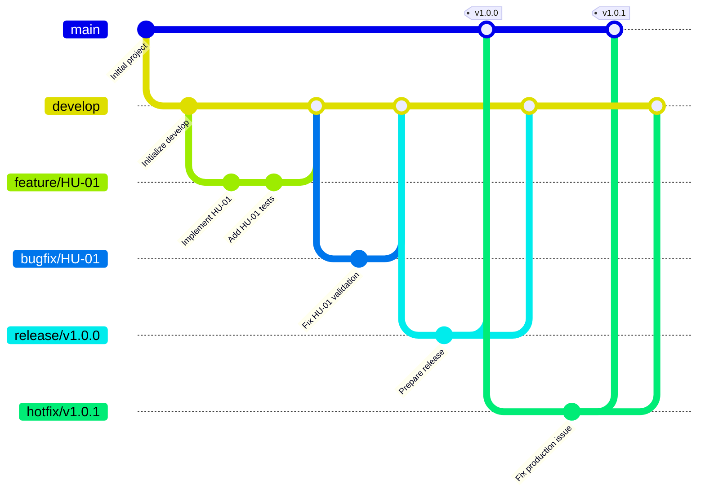

# AgroValle Connect

## Descripción
Aplicación web empresarial (desarrollada en Java 17 / Spring Boot) que busca transformar la cadena de suministro agroalimentaria regional al eliminar la intermediación innecesaria.

## 📌 Visión del Producto
**AgroValle Connect**. Su propósito es conectar de forma directa la oferta agrícola de las fincas del Valle del Cauca con la demanda comercial urbana de municipios como Cali o sus alrededores, garantizando un comercio más justo, eficiente y transparente para productores y compradores. Todo mediante una plataforma que es accesible y fácil de manejar para los usuarios, destacando las diferentes formas de ventas agrícolas tradicionales, compartiendo además calidad y experiencias tanto con clientes como vendedores.

---

##  Integrantes
- Ethan Alejandro Mezu Quizaboni
- Julián David Peña Chocue
- Bairon Palacios Urrutia
- Nicolle Mera Gomez

---

## Estrategia de Ramificación (Git Flow)

Git Flow es una estrategia muy sencilla, clara y ordenada para equipos que especialmente se encuentran en etapa de aprendizaje. Además, trabajar con el flujo de control de versiones estructurado facilita la gestión de funcionalidades nuevas, correcciones y versiones que se encuentren en producción. También ayuda a mantener una comunicación constante con el equipo sobre cada cambio que se vaya realizando, reduciendo así la probabilidad de errores en la rama `main`.

**Guía rápida de ramas:**

- `main`: Contiene únicamente código estable y listo para producción.
- `develop`: Rama principal de integración donde se consolidan todas las nuevas funcionalidades antes de su liberación.
- `feature/*`: Ramas derivadas de `develop` para desarrollar una Historia de Usuario o tarea específica. Se recomienda utilizar nombres descriptivos.
- `hotfix/*` / `bugfix/*`: Ramas dedicadas a la corrección rápida de errores en producción o en etapas de integración.

>[!IMPORTANT]
> - No trabajaremos directamente sobre `main` ni `develop`.
> - Para cada tarea o Historia de Usuario creamos una rama `feature/*`. Evitar crear ramas demasiado generales.
> - Los mensajes de commit se escribirán en inglés siguiendo Conventional Commits.
> - Los nombres de las ramas pueden utilizar español e inglés, siempre que sean descriptivos y consistentes.
> - Luego de trabajar en las ramas creadas, hacemos un Pull Request hacia `develop`.
> - Cualquier duda, contactarse con un integrante de equipo antes de hacer algún cambio.
---

### Diagrama del Flujo de Ramas (Mermaid)



---
## Configuración de la base de datos

El proyecto utiliza PostgreSQL y requiere configurar las siguientes variables de entorno:

```bash
export DB_USERNAME=postgres
export DB_PASSWORD='TU_CONTRASEÑA_DE_POSTGRES'
```
**Nota:** No se debe subir la contraseña real al repositorio. Cada desarrollador debe configurar sus propias variables de entorno localmente.

## Variables de entorno para desarrollo local

Para ejecutar la aplicación en su computador, cada desarrollador debe definir estas variables:

```bash
export DB_URL='jdbc:postgresql://localhost:5432/agrovalle'
export DB_USERNAME=postgres
export DB_PASSWORD='TU_CONTRASEÑA_DE_POSTGRES'
export JWT_SECRET="$(openssl rand -base64 32)"
```

`JWT_SECRET` debe ser un texto en Base64 de al menos 32 bytes. Genere uno propio y no reutilice el de staging.

---

## Despliegue continuo (CD) a staging

Cada vez que se hace merge a `develop`, GitHub Actions ejecuta las pruebas y, si pasan, despliega la aplicación al entorno de staging.

| Entorno | Rama | Aplicación | Base de datos |
|---|---|---|---|
| Pruebas (CI) | cualquier rama | no se despliega | H2 en memoria |
| **Staging** | `develop` | Render: https://agrovalle-staging.onrender.com | PostgreSQL en Supabase |

### Flujo

1. Se hace merge de un Pull Request a `develop`.
2. El workflow `.github/workflows/cd-staging.yml` corre las pruebas y Checkstyle.
3. Empaqueta la app y la arranca contra la base de datos de staging (prueba de humo: `POST /api/v1/auth/login` con un usuario inexistente debe responder 401).
4. Si todo pasó, llama al Deploy Hook de Render, que construye la imagen con el `Dockerfile` y publica la nueva versión.

El Auto-Deploy de Render está **desactivado** a propósito: solo se despliega cuando el pipeline lo ordena.

### Secretos de GitHub Actions

Están configurados en **Settings → Secrets and variables → Actions**. Los colaboradores **no** necesitan crearlos y no pueden ver sus valores.

| Secreto | Descripción |
|---|---|
| `STAGING_DB_URL` | URL JDBC del Session pooler de Supabase |
| `STAGING_DB_USERNAME` | Usuario de la base de datos de staging |
| `STAGING_DB_PASSWORD` | Contraseña de la base de datos de staging |
| `STAGING_JWT_SECRET` | Clave Base64 para firmar los tokens JWT |
| `RENDER_STAGING_DEPLOY_HOOK` | URL que ordena el despliegue en Render |

> [!IMPORTANT]
> - Nunca suban contraseñas, URLs con credenciales ni claves al repositorio.
> - Si un secreto debe cambiar, avisen al administrador del repositorio.
> - No compartan las credenciales de Supabase ni de Render por chat.

### Base de datos de staging

El esquema está en `main/resources/schema.sql` (14 tablas) y las 7 categorías de producto se cargan por separado. Si el esquema cambia, el script debe actualizarse también en Supabase de forma manual, porque el CD no migra la base de datos.

### Notas

- **Staging usa el plan gratuito de Render:** tras 15 minutos sin tráfico el servicio se duerme y la primera petición puede tardar cerca de un minuto.
- **Supabase pausa los proyectos gratuitos** tras una semana sin actividad. Si el despliegue falla por conexión rechazada, hay que reactivarlo desde el panel.
- Para ejecutar el workflow a mano: **Actions → CD Staging → Run workflow**.